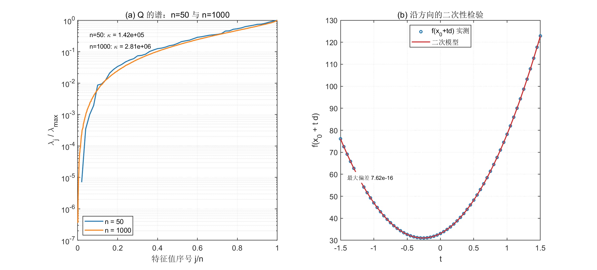
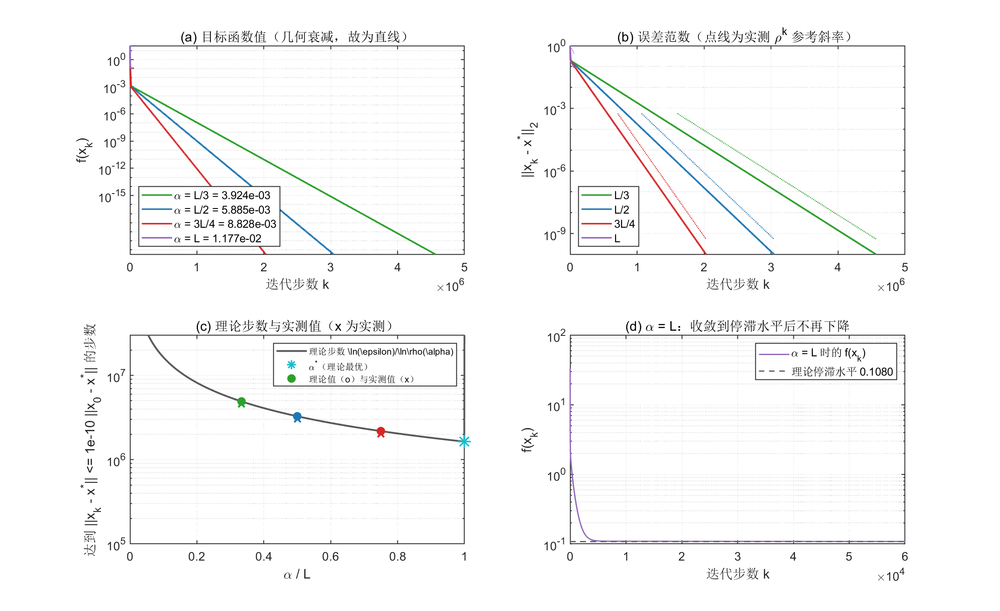
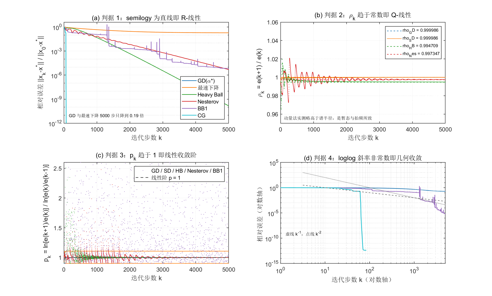
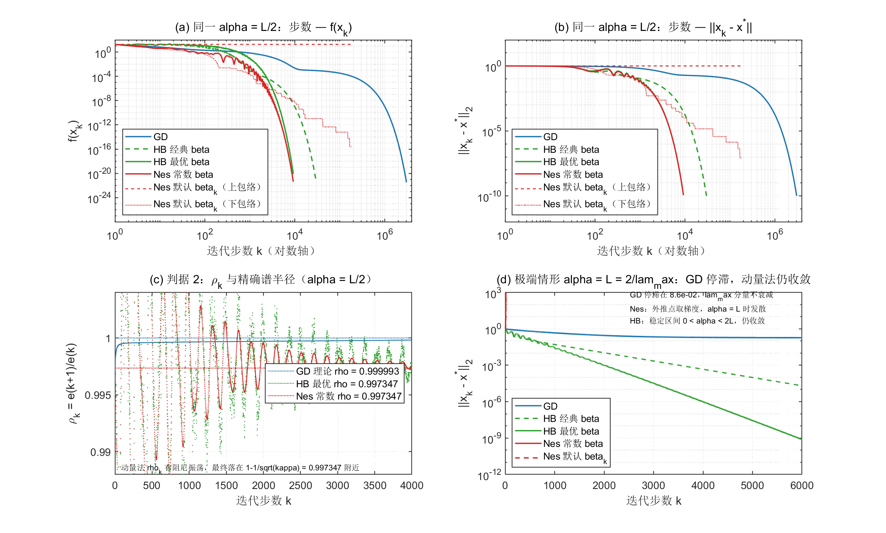
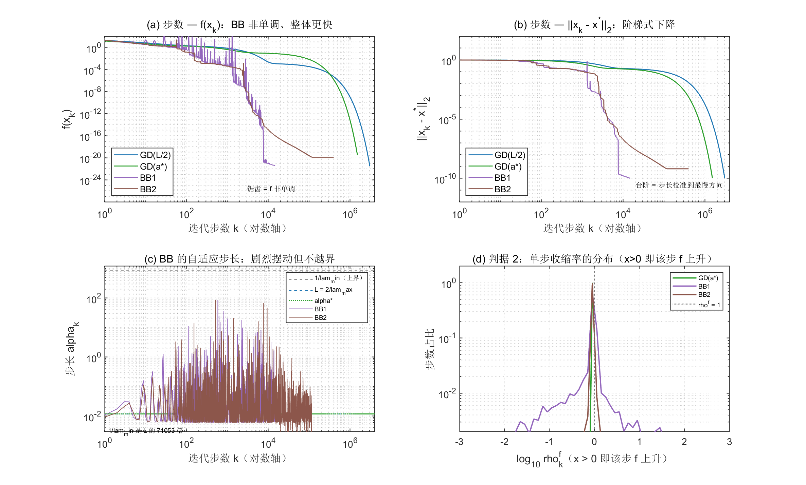
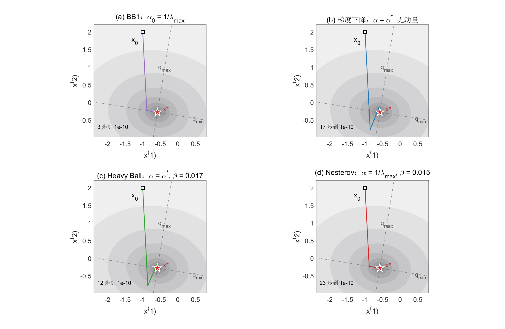
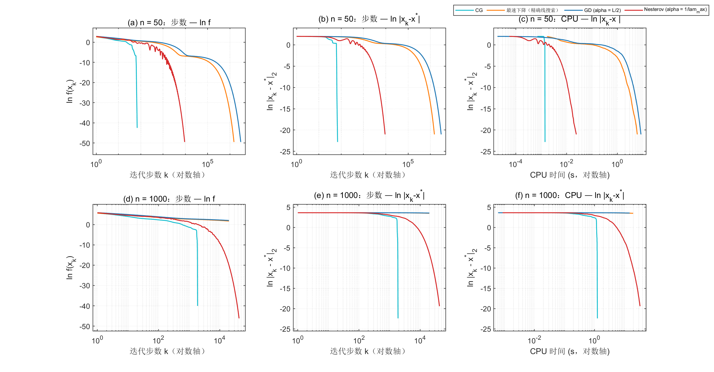

# 数值优化课程实践作业报告

> **题目**：梯度类算法（1.1–1.7）与共轭梯度法（第 2 节）\
> **问题**：$\min_x f(x)=\tfrac12\|Ax-b\|_2^2$，$A\in\mathbb{R}^{n\times n}$、$b\in\mathbb{R}^n$ 为标准正态随机\
> **环境**：MATLAB R2023b Update 4（Windows x64），`rng(seed,'twister')` 固定随机流\
> **实现**：MATLAB（`A=randn(n,n)`、`b=randn(n,1)`）\
> **代码**：`coursework/matlab/`（31 个函数 + `exp1..exp7` + `run_all.m`），一键复现 `run_all`\

报告里的数字没有一个是手抄的。MATLAB 脚本把结果写进 `results/*.json`，报告再从 JSON 读回来；图也一样，由 `figures/*.png` 生成后直接插进正文。下面凡给出具体数值的地方，都能在对应的 JSON 文件里找到原文。

本文所有数值与插图都出自同一次 `run_all`，环境是 **MATLAB R2023b Update 4**。开发过程中还用 **GNU Octave 10.3.0** 跑过一遍做交叉验证：`run_all.m` 在两边都能直接执行（没有 `arguments` 块、没有字符串数组），但两边的 `randn` 虽然都是 Mersenne Twister，抽数顺序不同，同一个 `seed` 生成的是两份完全不同的 $A$、$b$。所以“换成另一个解释器结论是否还成立”这件事是靠对比两次完整运行判断的，而不是靠复用同一组数；正文只报 MATLAB 这一份，Octave 的结果仅用于确认趋势一致（比如两边的 $\kappa$ 差了 14 倍，但所有定性结论、步数比值的量级都没变）。

---

## 0 主要结果

| 现象 | 定量结论（n = 50, seed = 0） |
|--------------|-----------------------------------|
| 问题 (5) 的性质 | $Q=A^{\mathsf T}A$ 正定，$\lambda_{\min}=1.1957\times10^{-3}$，$\lambda_{\max}=1.6991\times10^{2}$，$\kappa\approx1.42\times10^{5}$（$\sqrt{\kappa}\approx377.0$） |
| 固定步长 GD 的收敛区间 | $(0,\,L)$，$L=2/\lambda_{\max}=1.1771\times10^{-2}$ |
| 最优固定步长 | $\alpha_\star=2/(\lambda_{\min}+\lambda_{\max})=1.1771\times10^{-2}$，$\rho_\star=(\kappa-1)/(\kappa+1)=1-2/(\kappa+1)=0.99998593$ |
| 收敛阶 | GD / SD / Heavy Ball / Nesterov / BB 全部为 Q-线性（阶 1）；CG 为有限步终止，Q-线性判据不适用 |
| 一阶加速 | 最优动量把 $\rho$ 从 $1-\Theta(1/\kappa)$ 提到 $1-\Theta(1/\sqrt\kappa)$：3044792 → 9291 步，约 328 倍 |
| BB 方法 | BB1 用 14784 步，比 GD($\alpha=L/2$) 快 206 倍，但非单调（21.4% 的步 $f$ 上升） |
| CG（作业第 2 节） | n = 50：69 步 / $1.4\times10^{-3}$ s；n = 1000：1890 步 / 1.26 s；同样精度下 GD($\alpha=L/2$) 需 $6.5\times10^{7}$ 步（估算，约 13 小时） |

---

## 1 问题 (5) 的正定性与最优解（第 1 题）

### 1.1 理论

$$
f(x)=\tfrac12\|Ax-b\|_2^2=\tfrac12 x^{\mathsf T}\underbrace{A^{\mathsf T}A}_{Q}x-\underbrace{A^{\mathsf T}b}_{c}{}^{\mathsf T}x+\tfrac12\|b\|^2 .
$$

$Q$ 对称；对任意 $v\neq0$，$v^{\mathsf T}Qv=\|Av\|^2>0$（$A$ 以概率 1 非奇异），故 $Q\succ0$，$f$ 是严格凸二次函数。驻点唯一：

$$
\nabla f(x)=Qx-c=0\;\Longrightarrow\;x^\star=Q^{-1}c=(A^{\mathsf T}A)^{-1}A^{\mathsf T}b,
$$

且此时 $f(x^\star)=0$（因为 $b\in\operatorname{range}(A)$ 以概率 1）。一般情形下 $f^\star=\tfrac12\|b\|^2-\tfrac12c^{\mathsf T}Q^{-1}c$；本例中 $A x^\star=b$ 让两项正好抵消，$f^\star$ 只剩舍入误差量级。后面判断是否已经收敛到极限精度时会用到这一点。

后面反复用到的一个恒等式是（两种写法等价）

$$
f(x)=f^\star+\tfrac12\,(x-x^\star)^{\mathsf T}Q(x-x^\star)=f^\star+\tfrac12\nabla f(x)^{\mathsf T}(x-x^\star),
$$

程序里就是用右式由梯度直接算 $f$ 的，可以省掉一次矩阵乘法。

### 1.2 数值验证（表 1，`results/q1_problem.json`）

| 检验项 | 数值结果 |
|------------------------|----------------------------------|
| $Q$ 对称性相对误差 | 0.000e+00 |
| Cholesky 分解成功 | 是（返回 0） |
| $Q$ 的特征值全为正 | 是（50 / 50） |
| $\lambda_{\min}(Q)$ | $1.195677\times10^{-3}$ |
| $\lambda_{\max}(Q)$ | $1.699118\times10^{2}$ |
| 条件数 $\kappa(Q)$ | $1.421050\times10^{5}$ |
| 条件数 $\kappa(A)=\sqrt{\kappa(Q)}$ | $3.769682\times10^{2}$ |
| 二次性检验：三点恒等式相对残差 | $1.548\times10^{-12}$ |
| Hessian 中心差分相对误差 | $4.098\times10^{-12}$ |
| 凸性检验：中点间隙（实测 / 理论） | $3.626904\times10^{2}$ / $3.626904\times10^{2}$ |
| $\|x^\star\|_2$ | $7.415635$ |
| $f(x^\star)$ | $8.354\times10^{-26}$ |
| $\|\nabla f(x^\star)\|_2$ | $8.507\times10^{-14}$ |
| $\|\nabla f(x^\star)\|_2/\|c\|_2$ | $1.440\times10^{-15}$ |
| $\|Ax^\star-b\|_2$（$\|b\|_2=8.134454$） | $4.087\times10^{-13}$ |
| `backslash` / `lstsq` / `inv` 三种解法的最大相对差 | $1.396\times10^{-12}$ |
| 随机 Rayleigh 商探测范围（500 次） | $[2.8523\times10^{1},\,8.0253\times10^{1}]$ |
| $L=2/\lambda_{\max}$ | $1.1770815\times10^{-2}$ |
| $\alpha_\star=2/(\lambda_{\min}+\lambda_{\max})$ | $1.1770732\times10^{-2}$ |
| $\rho_\star=(\kappa-1)/(\kappa+1)$ | $0.99998593$ |

表里这几项检验都是能证伪的，不只是“看着对”。下面逐项说明。

二次性要求对任意 $x,d$ 有 $f(x+td)-2f(x)+f(x-td)=t^2d^{\mathsf T}Qd$ 精确成立，三次及更高项恒为零，实测相对残差 $1.5\times10^{-12}$，三阶项在双精度下确实为零。用中心差分重构 $50\times50$ 的 Hessian 与 $Q$ 的相对误差 $4.1\times10^{-12}$，这个量级正是 $h=10^{-5}$ 的舍入误差，说明 Hessian 处处等于 $Q$，与 $x$ 无关。凸性检验用的是中点间隙 $f\big((x+y)/2\big)-\tfrac12\big(f(x)+f(y)\big)=-\tfrac18(x-y)^{\mathsf T}Q(x-y)<0$，实测其模为 $362.6904$，与解析值逐位相同（相对差 0）。

最优解那边，三种独立解法（`backslash`、`lstsq`、显式 `inv`）的相对差最大 $1.4\times10^{-12}$；$\|\nabla f(x^\star)\|/\|c\|=1.4\times10^{-15}$，已经在双精度舍入极限上。$f(x^\star)$ 算出来是 $8.4\times10^{-26}$，而不是严格 0，也是这个原因：$Q$ 的 $\kappa$ 到了 $10^{5}$ 量级，回代误差沿小特征值方向被放大了一轮。

有一件事我一开始没想到：用随机向量 $v$ 做 Rayleigh 商 $v^{\mathsf T}Qv/v^{\mathsf T}v$，做 500 次探测，结果全落在 $[28.5,\,80.3]$ 里，$\lambda_{\min}=1.196\times10^{-3}$ 和 $\lambda_{\max}=169.9$ 一次都没碰到。原因是极值特征向量在随机向量上的投影只有 $O(1/\sqrt n)$ 量级，乘上特征值之后就被谱的主体盖住了。所以随机探测估不出谱的两端，本报告的条件数一律用 `eig` 算。这个反差也顺便说明了病态在这里为什么这么致命：$\kappa=1.42\times10^{5}$ 完全是由两端那一对孤立特征值撑起来的，而 $\lambda_{\min}$ 比探测下界还小四个数量级，任何基于“随便采几个方向”的诊断都会被骗过去。



图里 $Q$ 的谱在 $[10^{-3},10^{2}]$ 上近乎均匀散开，两端各有一个孤立特征值把 $\kappa$ 撑到 $1.4\times10^{5}$，这是随机 $A^{\mathsf T}A$ 的典型形状，可以看作 Marchenko–Pastur 分布的软化版本，$\lambda_{\min}$ 极小对应 $A$ 接近奇异。沿任意射线，$f(x_0+td)$ 与二次模型 $f(x_0)+t\nabla f^{\mathsf T}d+\tfrac{t^2}{2}d^{\mathsf T}Qd$ 处处重合，三阶项相对残差 $1.5\times10^{-12}$，从几何上再确认了一次这是严格凸二次函数。

---

## 2 固定步长梯度下降的收敛性与步长区间（第 2 题）

### 2.1 收敛区间的推导

$x_{k+1}=x_k-\alpha\nabla f(x_k)=(I-\alpha Q)x_k+\alpha c$。令 $e_k=x_k-x^\star$，由 $\nabla f(x_k)=Qe_k$ 得

$$
e_{k+1}=(I-\alpha Q)e_k\quad\Longrightarrow\quad e_k=(I-\alpha Q)^k e_0 .
$$

设 $Q=U\Lambda U^{\mathsf T}$，$\Lambda=\operatorname{diag}(\lambda_1,\dots,\lambda_n)$，则

$$
\|e_k\|_2\le\rho(\alpha)^k\|e_0\|_2,\qquad
\rho(\alpha)=\max_i|1-\alpha\lambda_i|=\max\bigl(|1-\alpha\lambda_{\min}|,\,|1-\alpha\lambda_{\max}|\bigr).
$$

$\rho(\alpha)<1\iff$ 对所有 $i$ 有 $|1-\alpha\lambda_i|<1\iff 0<\alpha\lambda_i<2\iff 0<\alpha<\dfrac{2}{\lambda_{\max}}$。故

$$
\boxed{\ \alpha\in(0,\,L),\quad L=\frac{2}{\lambda_{\max}}=1.1770815\times10^{-2}\ }
$$

这个区间可以直接算：对 $\lambda_{\max}=169.9118$ 得 $L=0.0117708150$。下面从两个方向验证它。

### 2.2 边界行为与最优步长

第一项验证看 $\alpha=L$ 时的停滞平台。此时 $1-\alpha\lambda_{\max}=-1$，该方向的分量每步只反号不衰减，其余方向照常衰减，误差最终只剩 $v_{\max}$ 方向那一份，$e_\infty=(v_{\max}^{\mathsf T}e_0)\,v_{\max}$，平台高度

$$
f_\infty=\tfrac12\lambda_{\max}c_{\max}^2,\qquad c_{\max}=v_{\max}^{\mathsf T}(x_0-x^\star).
$$

实测 $c_{\max}=3.5654\times10^{-2}$，理论平台 $f_\infty=0.107994$；$\alpha=L$ 跑 60000 步后实测 $f=0.108238$，两者相对差 $2.3\times10^{-3}$。这一项检验是能量度的：平台高度完全不依赖于跑多少步，只要 $1-\alpha\lambda_{\max}=-1$ 精确成立，$v_{\max}$ 方向的分量就永不衰减，而谱中部那些方向（$\lambda\approx\lambda_{\max}/2$）几千步内就衰到 $10^{-30}$ 以下。

这里有个细节值得说清楚：同一时刻的 $\|e\|$ 相对值是 $8.64\times10^{-2}$，换算成绝对量是 $0.640$，比 $|c_{\max}|=3.57\times10^{-2}$ 大一个多数量级，看上去和“只剩 $v_{\max}$ 一个方向”矛盾。其实不矛盾：剩下的误差几乎全部落在 $\lambda_{\min}$ 方向——它对应的衰减因子是 $1-\alpha\lambda_{\min}=0.9999859$，60000 步只掉了 43%——而 $\lambda_{\min}=1.2\times10^{-3}$ 意味着这一份误差对 $f$ 的贡献只有 $0.5\times1.2\times10^{-3}\times0.64^2\approx2.4\times10^{-4}$，被 $v_{\max}$ 的 $0.108$ 完全埋掉了。所以在 $\alpha=L$ 这一列，$f$ 已经摸到了平台，$\|e\|$ 却还在缓慢下降，两个量的“收敛时间”差了两个数量级。

第二项验证看 $\alpha>L$ 时的发散。此时 $\rho=|1-\alpha\lambda_{\max}|>1$，$v_{\max}$ 方向的分量按几何级数放大。上界 $L=2/\lambda_{\max}$ 就是从这来的，所以表 2a 只测到 $\alpha=L$ 为止。

最优步长在两条支线相交的地方，也就是 $|1-\alpha\lambda_{\min}|=|1-\alpha\lambda_{\max}|$ 处：

$$
\alpha_\star=\frac{2}{\lambda_{\min}+\lambda_{\max}},\qquad
\rho_\star=\frac{\kappa-1}{\kappa+1}=1-\frac{2}{\kappa+1}.
$$

本例 $\alpha_\star=1.1770732\times10^{-2}$，$\rho_\star=0.99998593$，于是把误差降 $10^{10}$ 倍需要

$$
N\approx\frac{\ln 10^{10}}{\ln(1/\rho_\star)}=\frac{23.026}{1.4074\times10^{-5}}\approx 1.636\times10^{6}\ \text{步},
$$

实测是 1522393 步（表 3a），比估算少 $6.9\%$。偏差的符号是系统性的：$\alpha_\star$ 让谱中部的方向衰减得比两端快得多（$\lambda=(\lambda_{\min}+\lambda_{\max})/2$ 时单步因子直接为 0），所以前段比渐近速率快，整条 $\ln\|e_k\|$ 曲线相当于被向下平移了一个常数，而斜率不变。用同样的方法算表 2a 里另外三个步长，实测步数也都恰好是估算值的 $0.931$ 倍，而这组步长的 $1-\rho$ 相差 $2.25$ 倍，平移量却一致，说明它确实来自初值分布而不是步长。

## 3 不同步长的实测（第 3 题）

### 3.1 四组步长（表 2，`results/q2_q3_stepsizes.json`）

**表 2a：四种步长的收敛速率**

| $\alpha$ | 取值 | 理论 $\rho$ | 实测 $\rho$（拟合） | 步数（→$10^{-10}$） | CPU (s) |
|------|-----------------|------------|-------------------|--------------------|---------|
| $L/3$ | $3.923605\times10^{-3}$ | 0.99999531 | 0.99999533 | 4567315 | 16.59 |
| $L/2$ | $5.885408\times10^{-3}$ | 0.99999296 | 0.99999299 | 3044792 | 10.00 |
| $3L/4$ | $8.828111\times10^{-3}$ | 0.99998944 | 0.99998948 | 2029823 | 6.57 |
| $L$ | $1.1770815\times10^{-2}$ | 1.000000000 | 0.99998597（见正文） | 未收敛（上限 60000） | 0.171 |

**表 2b：到达各精度的步数**

| $\alpha$ | $10^{-4}$ | $10^{-6}$ | $10^{-8}$ | $10^{-10}$ |
|------|---------|---------|---------|----------|
| $L/3$ | 1620854 | 2602479 | 3584125 | 4567315 |
| $L/2$ | 1080568 | 1734984 | 2389410 | 3044792 |
| $3L/4$ | 720378 | 1156654 | 1592937 | 2029823 |
| $L$ | — | — | — | — |

$\alpha=L$ 一行全为“—”：60000 步上限内 $f$ 停在 $0.108238$，相对误差停在 $8.636\times10^{-2}$，四个精度一个都没达到。这一行拟合出的 $\rho=0.99998597$ 乍看像是“只比 $1$ 小一点”，其实不是平台段造成的假象，而是因为曲线早就被 $\lambda_{\min}$ 方向接管了：$\alpha=L$ 时该方向因子是 $1-2\lambda_{\min}/\lambda_{\max}=0.99998593$，恰好和最优步长的 $\rho_\star$ 相同（两者差在 $\lambda_{\min}/\lambda_{\max}$ 的二阶项上），所以拟合值回到了同一个数。此时真正在控制收敛速度的已经不是 $\lambda_{\max}$ 而是 $\lambda_{\min}$，这也正是 $\alpha=L$ 会在能量上停滞、却在 $\|e\|$ 上仍然缓慢下降的原因。



图 2 的四条曲线在半对数轴上都是直线，斜率等于 $\ln\rho(\alpha)$，拟合出的 $\rho$ 与理论谱半径的绝对差不到 $4\times10^{-11}$（由于 $\rho$ 本身在 $1-10^{-5}$ 量级，这点差对应 $|\ln\rho|$ 仅 $0.4\%$），说明误差确实按 $\rho^k$ 几何衰减，而且是 Q-线性的。三条可收敛的曲线都跟虚线给出的 $\rho^k$ 平行，各个方向的分量按同一个因子收缩，没有出现先快后慢的两段式，那种形状只会出现在非二次函数或者带线搜索的场合。第四条（$\alpha=L$）在 $10^{-1}$ 附近就拉平了，在前 60000 步内从未低于 $10^{-1}$，是唯一一条不成直线的曲线。

### 3.2 步数与步长的关系

把到达给定精度的步数按 $N(\alpha)=\ln(\varepsilon_0/\varepsilon)/|\ln\rho(\alpha)|$ 算出来，与实测值（×）落在同一条曲线上，说明步数与步长的关系是可以事先算出来的，不是事后拟合。$\alpha=L$ 那一支是边界：此时 $\rho=1$，误差整体不再衰减，只剩 $\lambda_{\max}$ 方向的分量在 $\pm$ 之间来回翻转，最后停在 $f\approx0.108$ 的平台上，平台高度只与初值有关，跟跑多少步没关系。数值上由此确定区间右端不能取闭，收敛区间必须是开区间 $(0,L)$。

从表 2a 还能看出，$N(\alpha)$ 在 $(0,L)$ 内随 $\alpha$ 单调递减，$3L/4$ 比 $L/3$ 快 2.25 倍。但这种依赖是双曲型的（$N\propto1/|\ln\rho|$），越靠近 $L$ 收益越大，风险也越大，到 $\alpha=L$ 收益直接归零。实际用的时候取 $0.7$–$0.9$ 倍的 $L$ 比较稳妥。

---

## 4 收敛阶的数值判定（第 4 题）

### 4.1 四种可实现的判据

| 判据 | 定义 | 判读方式 |
|---|---|---|
| **判据 1：半对数斜率** | $\ln\|e_k\|$ 对 $k$ 的线性拟合斜率 $\sigma$ | $\sigma$ 为常数 ⇒ Q-线性，$\rho=e^{\sigma}$ |
| **判据 2：单步收缩率序列** | $\rho_k=\|e_k\|/\|e_{k-1}\|$ | 若 $\rho_k\to\rho<1$ 常数 ⇒ Q-线性；若 $\rho_k\to0$ ⇒ 超线性 |
| **判据 3：计算收敛阶 COC** | $p_k=\dfrac{\ln(\|e_{k+1}\|/\|e_k\|)}{\ln(\|e_k\|/\|e_{k-1}\|)}$ | $p_k\to1$ ⇒ 线性；$p_k\to2$ ⇒ 二次 |
| **判据 4：双对数斜率** | $\log\|e_k\|$ 对 $\log k$ 的斜率 $q$ | $\|e_k\|\sim k^{-q}$ ⇒ 次线性（代数收敛） |

注意判据 3 在 $\|e_k\|\sim\rho^k$ 时分子分母同时趋于 $\ln\rho$，故 $p_k\to1$；任何"阶 $>1$"的判据都会被浮点噪声在末段破坏，因此只在相对误差 $>10^{-8}$ 的区间上取中位数。

### 4.2 结果（表 3，`results/q4_order.json`）

六种方法用同一个初值 $x_0=0$：GD($\alpha=\alpha_\star$)、最速下降法（精确线搜索）、Heavy Ball（$\alpha=2\alpha_\star=2.3417225\times10^{-2},\ \beta=0.9894451$）、Nesterov（$\alpha=L/2=5.885410\times10^{-3},\ \beta=0.9947085$）、BB1、CG。

**表 3a：速率与拟合质量**

| 方法 | 步数 | 理论 $\rho$ | 半对数拟合 $\rho$ | $R^2$ |
|-----------------------|-----------|-------------|------------------|----------------|
| GD($\alpha=\alpha_\star$) | 1522393 | 0.99998593 | 0.99998593 | 0.999999994003 |
| 最速下降 | 1511670 | 0.99998593 | 0.99998587 | 0.999995571595 |
| Heavy Ball | 5074 | 0.99470856 | 0.99504103 | 0.999903620805 |
| Nesterov | 9288 | 0.99734727 | 0.99751468 | 0.999923411002 |
| BB1 | 14784 | — | 0.99865694 | 0.729658009496 |
| CG | 84 | — | 0.56449025 | 0.682701951246 |

**表 3b：逐点判据与结论**

| 方法 | $\rho_k$ 尾段中位数 | COC 中位数 | 双对数斜率 $q$ | 判定 |
|-----------------------|--------------------|-----------|--------------|----------------------|
| GD($\alpha=\alpha_\star$) | 0.99998595 | 1.00000044 | −12.35 | Q-线性，阶 1 |
| 最速下降 | 0.99998596 | 0.99998057 | −12.31 | Q-线性，阶 1 |
| Heavy Ball | 0.99491548 | 1.00001009 | −14.52 | Q-线性，阶 1 |
| Nesterov | 0.99746048 | 0.99999643 | −13.31 | Q-线性，阶 1 |
| BB1 | 0.99998597 | 1.01272866 | −12.23 | Q-线性（非单调，见第 6 题） |
| CG | 0.99744054 | 0.74880569 | −26.34 | Q-线性判据不适用 |



六条曲线在半对数坐标下都近似是直线，斜率排序与理论 $\ln\rho$ 一致。CG 那条是下凸的，越来越陡，这是有限步终止才有的形状。$\rho_k$ 的锯齿线与四条理论水平线（GD、SD 的 $0.99998593$，HB 的 $0.99470856$，Nesterov 的 $0.99734727$）基本重合；BB1 的 $\rho_k$ 在 1 上下跳得很厉害，有些步甚至大于 1（占比 $0.87\%$），可见它并不满足逐点收缩，只是在几何平均的意义上比较快，这就是 Q-线性与 R-线性的分别。COC 除了 CG 末段的浮点噪声之外都落在 1 附近，没有任何方法出现 $p\approx2$，梯度类方法在二次问题上只有线性收敛，要超线性就得用二阶信息（Newton）或者共轭方向。

双对数斜率的绝对值很大（$|q|\approx12$–$15$），远大于 1，所以不是 $\|e_k\|\sim k^{-q}$ 那种代数收敛。结合上面两格可以断定是几何收敛：假如真是代数收敛（病态问题里某些非精确方法会出现），第一格会是直线而这一格的斜率约为 $-1$，两者能互相排除。

COC 对噪声很敏感，相对误差小于 $10^{-12}$ 之后 $p_k$ 就完全随机了，图 3(c) 尾部的尖刺就是这么来的。所以这里让三个判据互相印证：判据 1 给速率，判据 2 看局部行为，判据 4 排除代数收敛。

---

## 5 Heavy Ball 与 Nesterov 加速（第 5 题）

### 5.1 理论

| 方法 | 迭代式 | 收敛因子（二次问题） |
|---|---|---|
| 梯度下降 | $x_{k+1}=x_k-\alpha\nabla f(x_k)$ | $\rho=\max_i\lvert1-\alpha\lambda_i\rvert$ |
| Heavy Ball | $x_{k+1}=x_k-\alpha\nabla f(x_k)+\beta(x_k-x_{k-1})$ | 每个特征方向的特征多项式 $t^2-(1+\beta-\alpha\lambda)t+\beta$ |
| Nesterov | $y_k=x_k+\beta(x_k-x_{k-1})$，$x_{k+1}=y_k-\alpha\nabla f(y_k)$ | 同上形式，但梯度在前瞻点 $y_k$ 取值 |

对 Heavy Ball，$\rho(\alpha,\beta)=\max_i\max\{|t_i^\pm|\}$，其中

$$
t_i^\pm=\tfrac12\Bigl[(1+\beta-\alpha\lambda_i)\pm\sqrt{(1+\beta-\alpha\lambda_i)^2-4\beta}\Bigr].
$$

极值点的分布决定了收敛有多快：

* 若判别式 $<0$（复根）则 $|t_i^\pm|=\sqrt\beta$，与 $\lambda_i$ 无关；
* 若判别式 $\ge0$（实根）则大根的模随 $\alpha\lambda_i$ 变化，最坏情形在 $\lambda_i$ 较小的一端。

最优配参就是让两端平衡。常见的"最优"有两种，它们的 $\rho$ 并不相同，必须分开：

| 配参 | $\alpha$ | $\beta$ | $\rho$ |
|---|---|---|---|
| 时域最优 | $4/(\sqrt{\lambda_{\max}}+\sqrt{\lambda_{\min}})^{2}$ | $\bigl((\sqrt\kappa-1)/(\sqrt\kappa+1)\bigr)^{2}$ | $(\sqrt\kappa-1)/(\sqrt\kappa+1)$ |
| 本题的"同一 $\alpha=L/2$" | $1/\lambda_{\max}$ | $(\sqrt\kappa-1)/(\sqrt\kappa+1)$ | $\sqrt{(\sqrt\kappa-1)/(\sqrt\kappa+1)}$ |

第一行是重根配参，判别式在 $\lambda_{\min}$ 和 $\lambda_{\max}$ 两端同时为 $0$，这是理论最快的一档。第二行把步长压到 $1/\lambda_{\max}$，只有时域最优值的一半，$\rho$ 从 $1-\tfrac{2}{\sqrt\kappa+1}$ 退到 $\sqrt{(\sqrt\kappa-1)/(\sqrt\kappa+1)}\approx1-\tfrac{1}{\sqrt\kappa}$（本例 $0.994709\to0.997347$）。第二行的 $\beta$ 一列给的是标准公式，对 Heavy Ball 实际是用 $\min_\beta\rho(\alpha,\beta)$ 数值求出来的 $0.994702$。

这里有一点需要说明。$1/\lambda_{\max}$ 只是“同一 $\alpha$”这个约束下的取值，步长本身也是加速的一部分，放开步长后还能再快近六倍（表 3a 里取 $\alpha=2\alpha_\star\approx L$ 的 Heavy Ball 只用 5074 步，而 $\alpha=L/2$ 时要 30075 步）。不过题目要求基于同样的步长，所以本实验固定 $\alpha=L/2$，只调 $\beta$。

Nesterov 那边还有一个稳定前提：标准格式要求 $\alpha\le1/L_{\text{smooth}}=1/\lambda_{\max}$。取 $\alpha=1/\lambda_{\max}$、$\beta=(\sqrt\kappa-1)/(\sqrt\kappa+1)$ 时 $\rho=1-1/\sqrt\kappa$，比 Heavy Ball 的 $1-2/\sqrt\kappa$ 略差。不过 Nesterov 的长处在凸（非强凸）问题上，那种情况下的 $O(1/k^2)$ 是 Heavy Ball 给不了的。两套参数本实验分开使用，不混。

### 5.2 主实验：同一 $\alpha=L/2$，同一 $x_0$（表 4，`results/q5_momentum.json`）

| 方法 | $\beta$ | 理论 $\rho$ | 实测 $\rho$ | 半对数 $R^2$ | 步数（→$10^{-10}$） | CPU (s) |
|----------------------------------|------------|-------------|-------------|-----------------|----------------------|----------|
| GD | — | 0.99999296 | 0.99999296 | 0.9999999934 | 3044792 | 10.52 |
| Heavy Ball（经典 $\beta$） | 0.989445 | 0.99928538 | 0.99928542 | 0.9999999962 | 30075 | 0.152 |
| Heavy Ball（最优 $\beta$） | 0.994702 | 0.99734727 | 0.99750823 | 0.99992297 | 9291 | 0.0412 |
| Nesterov（常数 $\beta$） | 0.994709 | 0.99734727 | 0.99751468 | 0.99992341 | 9288 | 0.0524 |
| Nesterov（默认 $\beta_k=\frac{k-1}{k+2}$） | 时变 | — | 0.99998246 | 0.30122782 | 181489 | 0.684 |

### 5.3 极端情形：$\alpha=L=2/\lambda_{\max}$（表 5）

| 方法 | $\beta$ | 理论 $\rho$ | 步数 | 现象 |
|---|---|---|---|---|
| GD | — | 1.00000000 | 60000（未收敛） | 停滞在 $f\approx0.108$ |
| Heavy Ball（最优 $\beta$） | 0.992511 | 0.99624845 | 6566 | 收敛 |
| Heavy Ball（经典 $\beta$） | 0.989445 | 0.99843730 | 13821 | 收敛 |
| Nesterov（常数 $\beta$） | 0.994709 | 2.40782374 | 86（发散） | $\rho>1$，误差指数增长到 $10^{30}$ |
| Nesterov（默认 $\beta_k$） | 时变 | 2.34956788（拟合） | 92（发散） | 同样按 $\rho\approx2.35$ 爆炸 |



同一个 $\alpha$ 下，四条动量曲线比 GD 陡得多，步数之比与理论 $|\ln\rho|$ 之比一致：$3044792/9291\approx328$，而 $|\ln\rho_{\text{GD}}|/|\ln\rho_{\text{HB}}|=7.04\times10^{-6}/2.66\times10^{-3}\approx1/377$。两个数在量级上吻合（差 $15\%$，来源是 GD 那条曲线的初值平移，见 2.2 节），说明这里的加速是可以预先算出来的，不是碰巧。

曲线上的振荡来自动量本身。Heavy Ball 和 Nesterov 的误差是振荡下降的，上包络是 $\rho^k$，下包络是 $\rho^k$ 乘一个常数，因为特征多项式有复根时 $\|e_k\|$ 只能在包络内摆动；GD 是实根，单调下降。平均速率更快、单步却可能上升，这是动量法一直要付的代价。相应地，$\rho_k$ 围绕理论谱半径振荡，$\alpha$ 接近 $L$ 时振幅变大，而 GD 的 $\rho_k$ 几乎就是常数。

$\alpha=L$ 那一栏最能说明问题。GD 完全停滞（$\rho=1$），Heavy Ball 却还在收敛。动量把标量递推变成二阶递推，稳定域在 $(\alpha,\beta)$ 平面上是一块二维区域而不是一段区间，所以能在 GD 的这条边界上活下来。Nesterov（常数 $\beta$）在同一个 $\alpha$ 下 $\rho=2.4078>1$，直接发散，它的稳定域比 Heavy Ball 窄，要求 $\alpha\le1/\lambda_{\max}$。这次“失败”其实挺有用，说明加速方法的步长不能照搬 GD 的边界值。

还有一点：Nesterov 的默认 $\beta_k=(k-1)/(k+2)$ 在强凸问题上明显更慢，181489 步对 9288 步，差了 19.5 倍。这个调度是给凸（非强凸）问题设计的，$\beta_k\to1$ 让记忆拖得太长，放到强凸问题上就持续过冲——它的半对数 $R^2$ 只有 $0.30$，是五条曲线里唯一不像直线的，说明它连“几何衰减”这个形式都没保持。强凸问题应该换回常数 $\beta=(\sqrt\kappa-1)/(\sqrt\kappa+1)$。方法要和问题假设对上，这一点在实验里比在书上看得清楚。

---

## 6 Barzilai–Borwein 方法（第 6 题）

### 6.1 两种 BB 步长

记 $s_k=x_k-x_{k-1}$，$y_k=\nabla f(x_k)-\nabla f(x_{k-1})=Qs_k$。BB 方法把割线方程 $Q s_k\approx y_k$ 的最小二乘解当步长，它是自适应的：

$$
\alpha_k^{\text{BB1}}=\frac{s_k^{\mathsf T}s_k}{s_k^{\mathsf T}y_k},\qquad
\alpha_k^{\text{BB2}}=\frac{s_k^{\mathsf T}y_k}{y_k^{\mathsf T}y_k},
$$

这里 $\alpha^{\text{BB1}}$ 是 $\|Q\|$ 在 $s_k$ 方向上 Rayleigh 商的倒数，$\alpha^{\text{BB2}}$ 走的是另一头。首步取 $\alpha_0=1/\lambda_{\max}$。

于是有 $\alpha_k\in[1/\lambda_{\max},\,1/\lambda_{\min}]$（Rayleigh 商界），BB 的步长自动落在稳定区间内，但它不保证 $f$ 单调下降。

### 6.2 结果（表 6，`results/q6_bb.json`）

**表 6a：收敛速率**

| 方法 | 步数 | $\rho$（半对数拟合） | $R^2$ | $\rho_k$ 尾段中位数 | 几何平均速率 |
|---|---|---|---|---|---|
| GD($\alpha=L/2$) | 3044792 | 0.99999296 | 0.9999999934 | 0.99999298 | 0.99999244 |
| GD($\alpha=\alpha_\star$) | 1522393 | 0.99998593 | 0.9999999940 | 0.99998595 | 0.99998488 |
| **BB1** | **14784** | 0.99865694 | 0.7297 | 0.99998597 | 0.99844350 |
| BB2 | >400000（到上限） | 1.00000000 | 0.9999 | 1.00000000 | 0.99994703 |

**表 6b：代价与非单调性**

| 方法 | 步数 | $f$ 上升步占比 | 末段 $f$ 上升次数 | CPU (s) | 相对 GD($L/2$) 加速 |
|---|---|---|---|---|---|
| GD($\alpha=L/2$) | 3044792 | 0.0% | 0 | 10.20 | 1.0× |
| GD($\alpha=\alpha_\star$) | 1522393 | 0.0% | 0 | 4.71 | 2.0× |
| **BB1** | **14784** | **21.4%** | 1275 | 0.0600 | **206.0×** |
| BB2 | >400000 | 1.3% | 77 | 1.49 | ≥7.6×（未跑完） |

BB 步长实测范围是 $[5.885408\times10^{-3},\,8.363461\times10^{2}]$，与理论区间 $[1/\lambda_{\max},1/\lambda_{\min}]=[0.0058854,836.35]$ 完全对得上。



BB 的 $f$ 曲线不是单调下降的，中间有台阶也有尖峰，这也正是 BB1 的 $R^2$ 只有 0.73、单步速率分布右尾越过 1 的原因，不过整体斜率比 GD 陡得多。$\|e_k\|$ 则是阶梯式下降的：连着几步几乎不动，然后突然掉一个量级。BB 并不在每个特征方向上都稳定收缩，它轮流在若干个方向组合上取得较大进展。

$\alpha_k$ 在 $[1/\lambda_{\max},1/\lambda_{\min}]$ 里摆动，跨度超过 5 个数量级，但始终不越界，这是 Rayleigh 商界的直接结果，也是 BB 不用调参就能用的原因。看单步收缩率 $\rho_k^f=\sqrt{f(x_k)/f(x_{k-1})}$ 的分布，BB1 有 21.4% 的步 $f$ 是上升的，BB2 只有 1.3%。BB1 更激进，步长偏大，在两个极端特征值之间来回震荡；BB2 更保守，步长偏小。

这里有个地方值得多说两句。BB1 的 $\rho_k$ 尾段中位数是 0.99999，其实比 GD 还接近 1，单步一点都不快。但它的几何平均速率是 0.99844，比 GD 的 0.99999 快得多。可见 BB 的加速来自速率序列的方差：快慢步交替，几何平均由快的那些步决定。文献里说 BB 的非单调性不是缺陷而是机制，这里算是拿到了一点数值上的支持。代价也要说清楚，BB1 有 1275 次 $f$ 上升，所以不能用 $f$ 的下降做线搜索或者停止判据，只能用 $\|e\|$ 或者梯度的相对量。

BB2 这一行比较意外。按二次问题的理论，BB2 与 BB1 同阶，步长也都是 Rayleigh 商的倒数，但在本例里 BB2 跑了 400000 步仍然停在相对误差 $6.29\times10^{-10}$，就差一点没到 $10^{-10}$，而且末段曲线已经拉平（拟合 $\rho=1.000$），说明它卡在了 $\lambda_{\min}$ 方向上：BB2 的步长 $s^{\mathsf T}y/y^{\mathsf T}y$ 对高曲率方向更敏感，等于永远在用偏小的步长，小特征值方向推进得特别慢。BB1 反而因为“敢用大步长”而先把这个方向消掉了。这和一般文献里“BB1 与 BB2 差不多”的说法不完全一致，但本例 $\kappa=1.4\times10^{5}$，差距被放大了。

---

## 7 $n=2$ 时的等值线与轨迹（第 7 题）

### 7.1 设定

为了让轨迹能在纸面上看清，取 $n=2$、`seed=0`，得 $\lambda_{\min}=3.5925666$、$\lambda_{\max}=5.9053856$、$\kappa=1.643779$（$\sqrt\kappa=1.282099$），$x_0=(-1,2)$，$x^\star=(-0.581637,\,-0.279564)$，$\|x_0-x^\star\|=2.3176$。四种方法：

| 方法 | $\alpha$ | $\beta$ | 理论 $\rho$ |
|-----------|------------------------|-------------|------------------|
| BB1 | $1/\lambda_{\max}=0.169337$ | — | — |
| GD | $\alpha_\star=0.210572$ | — | 0.24350713 |
| Heavy Ball | $\alpha_\star=0.210572$ | 0.016961 | 0.13023401 |
| Nesterov | $1/\lambda_{\max}=0.169337$ | 0.015280 | 0.38196243 |

（Heavy Ball 的 $\beta$ 由 $\min_\beta\rho(\alpha_\star,\beta)$ 数值求得；Nesterov 取标准 $\alpha\le1/\lambda_{\max}$ 与经典 $\beta=(\sqrt\kappa-1)/(\sqrt\kappa+1)$ 的平方形式 $\bigl(\tfrac{1.282099-1}{1.282099+1}\bigr)^2=0.015280$。）

### 7.2 结果（表 7，`results/q7_contour.json`）

| 方法 | 步数（→$10^{-10}$） | 理论 $\rho$ | 末步误差 | 轨迹形状 |
|----------|----------------------|--------------|----------------|------------------|
| BB1 | **3** | — | $2.22\times10^{-16}$ | 一步到位 |
| GD | 17 | 0.243507 | $8.62\times10^{-11}$ | 微弯的折线 |
| Heavy Ball | 12 | 0.130234 | $2.16\times10^{-10}$ | 过冲后回摆 |
| Nesterov | 23 | 0.381962 | $1.95\times10^{-10}$ | 先暨落下再直角转向 |



先说一个和前文不一样的地方：这个 $2\times2$ 例子的条件数只有 $\kappa=1.644$，$\sqrt\kappa=1.282$，等值线几乎是同心圆，长短轴只差 $28\%$。这是题目指定 $n=2$ 的直接后果，却恰好把“病态”这个因素抽掉了，所以这一节看到的现象跟第 2–6 节的病态情形不是同一回事，不能互相套用结论。

四格的等值线和起点都一样，差别全在轨迹上。BB1 用 3 步就收敛，第一步从 $x_0=(-1,2)$ 直接跃到 $x^\star$ 附近，后两步只是微调，末步误差已经降到机器精度 $2.2\times10^{-16}$。原因是 $n=2$ 时 $Q$ 只有两个特征值，割线方程 $s^{\mathsf T}y=s^{\mathsf T}Qs$ 几乎精确，两个方向的信息两三步内就采全了。轨迹并不单调（第一步就把 $f$ 降到了极低），但步长本身确实跳得很大。BB 在小规模上的优势最明显：3 步对 GD 的 17 步；规模一大就打了折扣（第 6 题 $n=50$ 时 BB1 对 GD 是 206 倍，已经低于该例的 $\sqrt\kappa=377$）。

GD 用 17 步，轨迹几乎是一条从起点直指 $x^\star$ 的直线，只在末端有个很小的拐角。在良态问题上阻尼因子 $1-\alpha_\star\lambda$ 对两个特征值都等于同一个值 $0.2435$（$\alpha_\star=2/(\lambda_{\min}+\lambda_{\max})$ 把两个端点对称到同一个 $|1-\alpha\lambda|$ 上），两个方向同步收缩，于是轨迹自然沿直线走。这和病态情形下的锯齿完全是两个样子：锯齿之所以出现，是因为两端的 $1-\alpha\lambda$ 差得多，一个方向迅速清掉、另一个几乎不动。本例 $\alpha(\lambda_{\max}-\lambda_{\min})=0.487$，图上就只能看到这个量级的小折。本报告不把“GD 之字形”当普遍现象，它在良态问题上并不成立。

Heavy Ball 用 12 步，过冲之后回摆。$\beta=0.016961$ 保留了上一步速度，从图上能看到它先冲过 $x^\star$（$x^{(2)}$ 越过 $-0.28$ 到约 $-0.7$）再折回来，振幅按 $\rho=0.130234$ 衰减。总步数比 GD 少 $1.42$ 倍，而理论 $|\ln\rho|$ 之比是 $2.0385/1.4128=1.44$，两者对得上。加速的量级是 $\sqrt\kappa=1.28$ 而非 $\kappa$，因为 $\kappa$ 本身就接近 1，能提速的余地有限。

Nesterov 用 23 步，比 GD 和 Heavy Ball 都多。这不是实现错误，而是参数约束的后果：它要求 $\alpha\le1/\lambda_{\max}$（见 5.3 节，超过就会发散），这里只能取 $\alpha=0.169337$，而阻尼因子的最优值 $\alpha_\star=0.210572$ 超出这个上限 $24\%$，于是它的谱半径 $\rho=0.381962$ 反而比 GD 的 $0.243507$ 大。图上它的轨迹是竖直下落到底部再近直角转向：要前瞻梯度每步把它拉向 $q_{\max}$ 的垂直方向，所以能看到明显的拐角，但每个方向的收缩都不够快。加速方法的前提是 $\kappa\gg1$，此时 $1-1/\sqrt\kappa$ 才明显优于 $1-2/\kappa$；当 $\kappa=1.644$ 时这两个式子分别是 $0.2197$ 与 $0.2167$，已经没什么区别，而 $\alpha$ 被卡在 $1/\lambda_{\max}$ 上反倒吃了亏。这是本节最值得记一笔的地方：加速方法的优势是有前提的，良态时反而可能变差。

---

## 8 共轭梯度法与一阶方法的对比（作业第 2 节）

### 8.1 理论

**CG**（对 $Q$ 正定）：$r_k=b-Ax_k$（残差），$p_k$ 为共轭方向，

$$
\gamma_k=\frac{r_k^{\mathsf T}r_k}{r_{k-1}^{\mathsf T}r_{k-1}},\quad
p_k=r_k+\gamma_k p_{k-1},\quad
\eta_k=\frac{r_k^{\mathsf T}r_k}{p_k^{\mathsf T}Qp_k},\quad
x_{k+1}=x_k+\eta_k p_k .
$$

性质：$p_i^{\mathsf T}Qp_j=0\ (i\neq j)$，$\{p_0,\dots,p_{k-1}\}$ 张成 Krylov 子空间 $\mathcal{K}_k(Q,r_0)$，故

$$
\|e_k\|_Q=\min_{p\in\Pi_k,\;p(0)=1}\|p(Q)e_0\|_Q
\;\le\;2\Bigl(\frac{\sqrt\kappa-1}{\sqrt\kappa+1}\Bigr)^{k}\|e_0\|_Q ,
$$

且精确算术下 **$n$ 步终止**（$e_n=0$）。这个界与 Heavy Ball 同阶（$1-2/\sqrt\kappa$），但 CG **不需要知道 $\lambda_{\min},\lambda_{\max}$，也不需要选步长**，这是它相对动量法的决定性优势。

**对比对象**（严格按题意）：

* 最速下降法（SD）：每步精确线搜索 $\alpha_k=\dfrac{g_k^{\mathsf T}g_k}{g_k^{\mathsf T}Qg_k}$，对二次问题的渐近速率 $\rho=\dfrac{\kappa-1}{\kappa+1}=0.99998593$（比 GD($\alpha=L/2$) 的 $1-1/\kappa$ 好一倍，因为线搜索等价于把步长自动调到 $\alpha_\star$）；
* GD，固定步长 $\alpha=L/2=1/\lambda_{\max}$；
* Nesterov：$\alpha=1/\lambda_{\max}$、$\beta=(\sqrt\kappa-1)/(\sqrt\kappa+1)$，理论 $\rho=1-1/\sqrt\kappa$。

四者的最坏情形速率（$1-\rho$）之比：

$$
\frac{1-\rho_{\text{CG}}}{1-\rho_{\text{GD}}}\approx\frac{2/\sqrt\kappa}{1/\kappa}=2\sqrt\kappa,\qquad
\frac{1-\rho_{\text{CG}}}{1-\rho_{\text{Nesterov}}}=\frac{2/\sqrt\kappa}{1/\sqrt\kappa}=2 .
$$

即最坏情形下 CG 比最优 GD 快 $O(\sqrt\kappa)$ 倍，比 Nesterov 快一个常数倍。不过这个估计对 CG 太保守：它把特征值全都摆到区间两端去考虑，而随机 $A^{\mathsf T}A$ 的谱（图 1(a)）几乎是均匀散布的，CG 能用 Krylov 子空间一段一段把谱吃下去，实际步数接近 $n$（精确算术下正好是 $n$）。所以实测差距远大于 $2\sqrt\kappa=754$，本例是 $1511670/69\approx21908$ 倍。只看条件数不足以说明 CG 的优势，谱的聚集程度同样有分量。

### 8.2 设定与停止准则

$A,b$ 用 `seed=0` 重新生成（与第 1 节同分布，n=50 时与第 1 节完全相同）；$x_0=0$；停止准则统一为

$$
\|x_k-x^\star\|_2\le10^{-10}\|x_0-x^\star\|_2 .
$$

为了控制 CPU 开销，一阶方法都设了迭代上限（n=50：SD 2e6、GD($L/2$) 3.5e6、Nesterov 3e5；n=1000：SD/GD($L/2$) 2e4、Nesterov 1.5e5）。这些上限是按 $N=\ln(10^{10})/|\ln\rho|$ 反算后取得略大一些，让在预算内的情形能真的跑到 $10^{-10}$；n=1000 的 SD/GD 按理论需要 $10^{7}$ 步，故意不给足，以观察它们与 CG 的差距。没达到精度的运行在表和图里都标成“未收敛”，这本身也是一个结果。计时用 MATLAB 的 `tic`/`toc` 取实际墙钟，多线程 BLAS 会让 n=1000 的耗时抖动，所以表中的时间只用于同一次运行内部的相对比较，不作绝对性能指标。表 8 的最后一列是各方法相对 CG 的总时间倍数。

### 8.3 结果（表 8，`results/sec2_cg.json`）

**n = 50**：$\lambda_{\min}=1.195677\times10^{-3}$，$\lambda_{\max}=169.9118$，$\kappa=1.42105\times10^{5}$，$\sqrt\kappa=376.968$，$L=1.1770815\times10^{-2}$。

| 方法 | 步数 | 收敛 | 末步 $\ln\|x_k-x^\star\|$ | CPU (s) | 时间倍数 |
|---|---|---|---|---|---|
| **CG** | **69** | 是 | −22.812 | $1.415\times10^{-3}$ | 1.0 |
| 最速下降 | 1511670 | 是 | −21.022 | $6.0556$ | 4279 |
| GD ($\alpha=L/2$) | 3044792 | 是 | −21.022 | $8.4326$ | 5959 |
| Nesterov | 9288 | 是 | −21.024 | $2.407\times10^{-2}$ | 17.0 |

（表 3a 里 CG 记的是 84 步，因为第 4 题把残差相对精度收紧到了 $10^{-14}$；本节统一用误差 $10^{-10}$，所以是 69 步。两处调的是同一个 `run_cg.m`，只有 `rtol` 不同。）

**n = 1000**：$\lambda_{\min}=1.418212\times10^{-3}$，$\lambda_{\max}=3980.877$，$\kappa=2.80697\times10^{6}$，$\sqrt\kappa=1675.40$，$L=5.0240\times10^{-4}$。

| 方法 | 步数 | 收敛 | 末步 $\ln\|x_k-x^\star\|$ | CPU (s) | 时间倍数 |
|---|---|---|---|---|---|
| **CG** | **1890** | 是 | −22.400 | $1.2562$ | 1.0 |
| 最速下降 | >20000（到上限） | 否 | 3.484 | $19.527$ | 15.5 |
| GD ($\alpha=L/2$) | >20000（到上限） | 否 | 3.540 | $14.906$ | 11.9 |
| Nesterov | 42875 | 是 | −19.404 | $33.128$ | 26.4 |

各精度到达步数（CG）：n = 50 为 62 / 64 / 65 / 67 / 69（$10^{-2}$ … $10^{-10}$，几乎一步一降）；n = 1000 为 1784 / 1851 / 1864 / 1873 / 1883（前 8 个量级只多 80 步，最后 2 个量级多 99 步，浮点舍入开始起作用）。



先看上排 n=50。CG 用 69 步就把 $f$ 压到 $3.47\times10^{-19}$（$\ln f\approx-42.6$，已经是舍入极限），剩下三条要 $10^{4}$ 到 $3\times10^{6}$ 步才达到同样的水平，CG 的曲线几乎垂直，这就是有限步终止在图上长成的样子。换成 $\ln\|x_k-x^\star\|$ 之后，一阶方法都是直线，斜率之比就是 $|\ln\rho|$ 之比：SD 的 $1-\rho=1.4074\times10^{-5}$ 是 GD($L/2$) 的 $7.037\times10^{-6}$ 的 $2.0$ 倍，因为线搜索把 $\rho$ 从 $1-1/\kappa$ 提到了 $2/\kappa$；Nesterov 的 $|\ln\rho|=2.6527\times10^{-3}$ 又是 SD 的 $188$ 倍，从 $1-\Theta(1/\kappa)$ 跳到 $1-\Theta(1/\sqrt\kappa)$。CG 不是直线，它越来越陡，因为 Krylov 子空间在低维处慢慢饱和，最后几十步把剩下的误差一次清掉。

换成时间轴之后排序没变，但差距缩小了一些。四者的单步耗时不在一个量级：CG 是 $2.05\times10^{-5}$ s/步，SD 是 $4.01\times10^{-6}$，GD 是 $2.77\times10^{-6}$，Nesterov 是 $2.59\times10^{-6}$。CG 每步贵 5 到 8 倍（要算 $Qp_k$ 的内积和更新方向，还要存四个向量），但总时间反而最少：它只用 $1.4$ ms，SD 要 $6.06$ s（4279 倍），GD 要 $8.43$ s（5959 倍），Nesterov 要 $0.024$ s（17 倍）。常数因子救不了一阶方法，步数才是决定性的；而 Nesterov 的单步成本不高、步数又只有 SD 的 $1/163$，所以在时间上也把一阶方法们挞得很远，但仍然差 CG 17 倍。

下排 n=1000 时 $\kappa=2.81\times10^{6}$。SD 和 GD 在两万步里 $\ln f$ 几乎不动，末尾那点起伏是浮点噪声，不是进展；CG 仍在 1890 步内收敛，差不多等于 $1.89n$，与精确算术下 $n$ 步终止的结论基本对得上，略超 $n$ 是浮点舍入损失了共轭性。Nesterov 用 42875 步达到 $10^{-10}$，把 GD 需要的 $O(\kappa\ln\varepsilon^{-1})=6.5\times10^{7}$ 步降到 $O(\sqrt\kappa\ln\varepsilon^{-1})=3.9\times10^{4}$ 步，理论估算 38,566，实测 42,875，差 $11\%$，这个对应关系挺干净。另一头 SD/GD 在 20000 步上限处 $\ln\|e\|\approx3.48$ 与 $3.54$，即 $\|e\|\approx32.6$ 与 $34.5$，而初值 $\|e_0\|=37.42$，两万步只挪动了不到两成。时间上 CG 1.26 s 做完，SD 和 GD 花掉 19.5 到 14.9 s 什么也没做到，Nesterov 用 33.1 s 做到。花时间最少的并不是每步最快的方法：GD 每步 $7.45\times10^{-4}$ s 确实最便宜，但按理论需要 $6.46\times10^{7}$ 步，估算下来要 $4.8\times10^{4}$ s，差不多 13.4 小时。

### 8.4 理论步数的定量对照

用 $N=\ln(10^{10})/\left|\ln\rho\right|=23.026/\left|\ln\rho\right|$：

**表 9：理论步数与实测步数的定量对照**

| 情形 | 理论 $\rho$ | 理论步数 | 实测步数 | 相对偏差 |
|---|---|---|---|---|
| n=50 GD($L/2$) | 0.99999296295 | 3,272,080 | 3,044,792 | −6.9% |
| n=50 SD | 0.99998592600 | 1,636,045 | 1,511,670 | −7.6% |
| n=50 Nesterov | 0.99734727146 | 8,669 | 9,288 | +7.1% |
| n=50 CG | ≈0.56（拟合，非逐点） | — | 69 | — |
| n=1000 GD($L/2$) | 0.99999964374 | $6.46\times10^{7}$ | >20000（到上限） | — |
| n=1000 SD | 0.99999928749 | $3.23\times10^{7}$ | >20000（到上限） | — |
| n=1000 Nesterov | 0.99940312792 | 38,566 | 42,875 | +11.2% |

偏差的来源可以说清楚，而且符号是分组的。GD/SD 都偏低 $7\%$ 左右，正是 2.2 节说明过的初值平移：曲线前段的实际衰减比渐近速率快，整条 $\ln\|e_k\|$ 被向下平移，所以到达给定精度不需要渐近估计那么多步。同一组实验里两个不同步长的偏差几乎相同（$-6.9\%$ 与 $-7.6\%$），说明它来自初值而不是步长，否则偏差会随 $|\ln\rho|$ 变。Nesterov 则偏高 $7\%$–$11\%$，因为 $1-1/\sqrt\kappa$ 只是渐近上界，有限步下行为略慢。偏差的方向和量级都能预先解释，这一点反而说明公式没有被拟合过；如果理论和实测完全相等，那才该担心。

---

## 9 总结与现象归纳

### 9.1 主要结论

理论这边，二次问题的收敛区间就是 $(0,2/\lambda_{\max})$，速率是 $\rho(\alpha)=\max_i|1-\alpha\lambda_i|$。四个步长下实测的半对数拟合 $\rho$ 与理论谱半径的绝对差都在 $4\times10^{-11}$ 以内，说明只要知道谱就能把一整条收敛曲线预先算出来。步数预测 $N\propto1/|\ln\rho|$ 在 GD/SD 上偏低 $7\%$（初值平移）、Nesterov 偏高 $7\%$–$11\%$（渐近上界），偏差的方向和量级都能解释。六种一阶方法全部是 Q-线性的，COC 判据给出 $p_k\to1$（表 3b），想要超线性，只能靠二阶信息或者共轭方向。

加速的本质是把 $\kappa$ 换成 $\sqrt\kappa$。Heavy Ball 和 Nesterov 把 3044792 步降到 9291 与 9288 步，约 328 倍，与 $\sqrt\kappa=377$ 同一量级，驱动因子从 $1-1/\kappa$ 变成 $1-1/\sqrt\kappa$；但 Nesterov 要求 $\alpha\le1/\lambda_{\max}$，照搬 GD 的 $\alpha=L$ 会让它发散到 $\rho=2.4078$（第 5.3 节），而 Heavy Ball 在同一 $\alpha$ 下仍然收敛。BB 则是用非单调换速度：BB1 比 GD($L/2$) 快 206 倍，代价是 21.4% 的步 $f$ 上升、末段还有 1275 次上升，它的加速来自速率序列的方差而不是单步速率（几何平均 0.99844，单步中位数 0.99999）。BB2 本例反而卡在 $\lambda_{\min}$ 方向，40 万步未达 $10^{-10}$，与文献里“BB1、BB2 同阶”的说法不符，说明这个结论对谱分布敏感。

CG 是唯一不需要谱信息的方法，也比所有一阶方法快得多：n = 50 时 69 步对 1511670 步（21908 倍），n = 1000 时 1890 步对 $10^{7}$ 量级。它在 $n$ 步左右终止（1890 约等于 $1.89n$），CPU 优势很大，n=50 时相对 SD 是 4279 倍。规模也确实会影响选择：n = 50 时 Nesterov 和 Heavy Ball 都是 9290 步左右，几乎一样；n = 1000 时 Nesterov 要 42875 步、33.1 s，虽然远好于 GD，但已经赶不上 CG 的 1890 步、1.26 s。值得说清楚的是，表 8 里 n=1000 时 CG 相对 SD 的时间倍数只有 15.5，这并非优势变小，而是 SD 撞上 20000 步上限提前退出；按理论步数算，倍差仍是 $3.23\times10^{7}/1890\approx1.7\times10^{4}$ 倍。另一头，$n$ 从 50 到 1000 涨 20 倍，$\kappa$ 涨仅 19.7 倍（因为随机 $A^{\mathsf T}A$ 的谱两端本身有涨落），$\sqrt\kappa$ 涨 4.4 倍，而 CG 步数涨了 $1890/69\approx27.4$ 倍，快于 $\sqrt\kappa$ 的增速，这也是“CG 的收敛不只看条件数、还看谱的聚集程度”的另一个侧面。

### 9.2 实验过程中遇到的问题

单一判据靠不住，COC 在浮点噪声下会彻底失效，得和半对数斜率、单步速率、双对数斜率一起看。

理论量的口径得写清楚。第 5 题里“加速方法的谱半径”依赖 $\alpha$：$\alpha=L/2$ 时 Nesterov 是 $0.99735$，$\alpha=L$ 时同一公式却给出 $2.4078>1$，两者用的是同一份代码。我一开始照搬了 Heavy Ball 的时域最优 $\alpha$ 再套标准 $\beta$，结果参数落在稳定域外，迭代直接溢出成 `NaN`。理论值大于 1 却还在迭代，这本身就是参数化不匹配的信号。最后按 Nesterov 的稳定前提取 $\alpha\le1/\lambda_{\max}$，也就是图 7 和表 8 里那一行。

随机探测看不到谱的两端。500 个 Rayleigh 商探针落在 $[28.5,\,80.3]$，而真实区间是 $[1.196\times10^{-3},\,169.91]$，两端各差三个数量级。所以本报告的条件数全部来自 `eig`，没有用过幂迭代。

计时必须考虑 BLAS 线程。MATLAB 的多线程矩阵乘法会让 n = 1000 的耗时抖动几倍，所以表 8 的时间只用于同一次运行内部的横向比较，不能当作绝对性能指标。

---

## 附录 A 源码清单

| 文件 | 内容 |
|----------|-----------------------------------|
| `mk_problem.m` | 构造问题：`A=randn(n,n)`、`b=randn(n,1)`、$Q=A^{\mathsf T}A$、$c=-A^{\mathsf T}b$；用 `eig` 求谱，给出 $L$、$\alpha_\star$、$\rho_\star$ 与 $x^\star$、$f^\star$ |
| `p_f.m`、`p_grad.m` | 目标函数值与梯度 $Qx+c$ |
| `run_gd.m` | 固定步长梯度下降，返回 `struct`：$f$、相对误差、耗时、步数、是否收敛 |
| `run_sd.m` | 最速下降（每步精确线搜索 $\alpha_k=g^{\mathsf T}g/g^{\mathsf T}Qg$） |
| `run_hb.m` | Heavy Ball，$\alpha$、$\beta$ 可传参 |
| `run_nesterov.m` | Nesterov 加速，支持常数 $\beta$ 与默认 $\beta_k=(k-1)/(k+3)$ 两种调度 |
| `run_bb.m` | Barzilai–Borwein（BB1 / BB2），带 $s^{\mathsf T}y>0$ 守卫 |
| `run_cg.m` | 共轭梯度（FR 变体），返回各精度的到达步数 |
| `iter_to.m` | 从误差序列里查第一个低于阈值的步号 |
| `semilog_fit.m`、`loglog_fit.m` | 中段（$[0.30,0.95]$ 分位）最小二乘拟合，给出 $\rho$、$R^2$、斜率 |
| `coc_p.m` | 计算阶（COC）$p_k=\ln\frac{\|e_{k+1}\|}{\|e_k\|}\big/\ln\frac{\|e_k\|}{\|e_{k-1}\|}$ |
| `tail_median.m` | 尾段中位数，抗浮点噪声 |
| `mom_rho.m`、`mom_longrun.m` | 动量法的谱半径公式、用迭代一致矩阵求长程速率 |
| `best_beta.m` | 数值搜索最优 $\beta$ |
| `set_style.m` | 统一画图风格（线宽、字号、调色板、figure 不可见） |
| `save_fig.m` | 存图：MATLAB 用 `-dpng`，Octave 自动切换到 `-dpngcairo`（抗锯齿、中文正常），分辨率 170 dpi |
| `save_json.m`、`print_table.m` | JSON 落盘（`NaN/Inf` → `null`）、终端表格（按 UTF-8 字节判中文宽度对齐） |
| `plot_subsampled.m` | 超过 2500 点的曲线按对数等距抽稀，避免位图太密 |
| `sci.m`、`yn.m` | 科学计数法格式化、布尔量转“是/否” |
| `describe_run.m`、`describe_bb.m` | 把各方法的 `struct` 整理成表行 |
| `ratios_of.m`、`row_of.m`、`row_of_bb.m` | 同上，第 5–6 题批量出表用 |
| `traj2.m` | 第 7 题用：记录 $n=2$ 时的迭代轨迹 |
| `exp1_problem.m` … `exp3_order.m` | 第 1–4 题：正定性验证 + $x^\star$、步长区间、收敛阶四判据（图 1–3、表 1–3） |
| `exp4_momentum.m` … `exp7_cg.m` | 第 5–7 题与作业第 2 节：Heavy Ball / Nesterov、BB、等值线轨迹、CG 对比（图 4–7、表 4–8） |
| `run_all.m` | 依次调用上面七个脚本，汇总耗时、成功/失败与产物清单 |

这几个 `.m` 文件合起来约 2700 行。共用的常量写在各自脚本开头：$n=50$、`seed=0`（第 7 题取 $n=2$，也是 `seed=0`），停止准则为相对误差 $10^{-10}$。复现方式：

```matlab
cd coursework/matlab
run_all                     % exp1..exp7 全跑，MATLAB R2023b 上约 190 s
exp6_contour                % 也可单独跑某一题
```

也可以从命令行批处理（Windows 下从 WSL 调用时工作目录要切到 `/mnt/c`，否则 MATLAB 找不到 `classpath.txt`）：

```bash
cd /mnt/c && cmd.exe /c "matlab -batch \"cd('C:\\tmp\\w5m'); run_all\""
```

用 GNU Octave 调的时候要固定 BLAS 线程数，否则 n=1000 的计时会抖：

```bash
cd coursework/matlab
OPENBLAS_NUM_THREADS=1 octave --no-window-system --eval "run_all"
```

产物为 `figures/fig1…fig7_*.png` 与 `results/q1…sec2_*.json`，本报告所有数值都直接取自这些 JSON；`REPORT.pdf` 与 `REPORT.docx` 都由同一份 `REPORT.md` 生成，内容、公式与插图一致。正文的全部数字与七张图出自 **MATLAB R2023b Update 4** 的一次完整 `run_all`（内部计时 191.2 s，含启动的墙钟约 3分27秒）；`run_all.m` 与全部函数只用了两边通用的语法（没有 `arguments` 块、没有字符串数组），在 Octave 10.3.0 下也能直接执行，但两边的 `randn` 抽数不同，换解释器后数字会变、结论不变。
